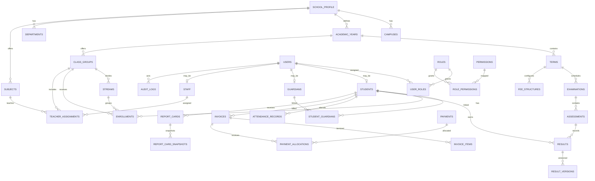

# School Management System — ERD and Data Dictionary (Phase 1 proposal)

## ERD overview

## Conventions

MySQL 8 / InnoDB / `utf8mb4`; internal IDs are `BIGINT UNSIGNED` unless an opaque public token is needed. Store timestamps consistently (UTC recommended) and render in `Africa/Dar_es_Salaam`. Important mutable records carry `created_at`, `updated_at`, `created_by`, `updated_by` where applicable. Soft deletion is only for safely archivable records. Financial transactions and published academic versions are never physically deleted through normal workflows. Money uses `DECIMAL(14,2)`; weights/percentages use bounded `DECIMAL`; never `FLOAT` for money. Foreign keys restrict deletion by default. Index foreign keys and common filters; encode business identity with unique constraints.

## Proposed table dictionary

| Domain | Tables and key fields | Integrity and purpose |
|---|---|---|
| School | `school_profile(id, name, motto, logo_path, address, phone, email, website, timezone, currency)`; `campuses`; `departments`; `system_settings` | Configurable branding and school setup; no school identity hardcoded in business logic. |
| Calendar | `academic_years(id, name, starts_on, ends_on, status)`; `terms(id, academic_year_id, name, starts_on, ends_on, status)`; `school_events` | Unique year name; term dates constrained to the year; indexes on dates/status. |
| Academic structure | `class_groups(id, academic_year_id, level, name, capacity)`; `streams(id, class_group_id, name)`; `subjects(id, code, name, level, active)`; `grading_scales`; `grade_boundaries` | Unique class/stream within year; grade ranges cannot overlap; preserve scale versions for published results. |
| Identity/RBAC | `users(id, username, nullable email, phone, password_hash, status, demo_account, last_login_at)`; `roles`; `permissions`; `user_roles`; `role_permissions`; `user_sessions`; `login_attempts` | Unique normalized email; password hash only; support scoped roles; local demo guard. |
| Students/guardians | `students(id, admission_number, legal_names, dob, gender, admission_date, status, photo_document_id)`; `guardians(id, user_id, relationship/contact)`; `student_guardians(student_id, guardian_id, relationship, verification_status, verified_by, verified_at)`; `student_documents` | Unique admission number; many-to-many verified links; restrict sensitive columns. |
| Enrollment/history | `enrollments(id, student_id, academic_year_id, class_group_id, stream_id, status, started_at, ended_at)`; `enrollment_events` | One active enrollment per student/year; transfers/promotions append history. |
| Staff/assignments | `staff(id, user_id, employee_number, department_id, employment_status, hired_at)`; `qualifications`; `teacher_assignments(id, staff_id, academic_year_id, class_group_id, stream_id, subject_id, role)`; `staff_attendance`; `leave_requests` | Unique employee number; assignment-scoped teacher permissions; conflict checks in service. |
| Assessment/results | `examinations(id, term_id, name, type, opens_at, closes_at, workflow_status)`; `assessments(id, examination_id, subject_id, class_group_id, max_mark, weight, grading_scale_id)`; `results(id, assessment_id, student_id, mark, status, current_version)`; `result_versions(id, result_id, version, mark, grade, comments, changed_by, reason, created_at)`; `result_approvals` | Unique result per assessment/student; mark within 0..max; workflow in service/policy; immutable version history. |
| Attendance | `attendance_sessions(id, class_group_id, stream_id, session_date, period, taken_by, status)`; `attendance_records(id, session_id, student_id, state, reason, recorded_by, correction_of)` | Unique student/session; states present/absent/late/excused/early departure; correction requires reason/audit. |
| Homework | `assignments(id, teacher_assignment_id, title, instructions, due_at, status)`; `assignment_files`; `submissions(id, assignment_id, student_id, submitted_at, status, feedback, mark)`; `submission_files` | Assignment limited to assigned class/subject; validated private files. |
| Finance | `fee_structures(id, term_id, class_group_id, code, amount DECIMAL, due_date)`; `invoices(id, student_id, term_id, invoice_number, status, issued_at, due_at)`; `invoice_items(id, invoice_id, fee_structure_id, description, amount DECIMAL, discount DECIMAL)`; `payments(id, payer_user_id, amount DECIMAL, currency, method, reference, status, idempotency_key)`; `payment_allocations(id, payment_id, invoice_id, amount DECIMAL)`; `refunds`; `financial_adjustments`; `payment_callbacks` | Unique invoice number, provider reference and idempotency key; immutable history; transactional allocations and balance recalculation. |
| Reports/documents | `documents(id, owner_type, owner_id, category, private_path, mime_type, size, checksum)`; `report_cards(id, student_id, term_id, examination_id, report_number, published_at, verification_token_hash)`; `report_card_snapshots(id, report_card_id, payload_json, branding_snapshot_json, pdf_path, checksum, created_at)` | Unique report/token; immutable snapshot; public QR check returns validity only, never marks or identity. |
| Communication | `announcements`; `messages`; `parent_meetings`; `notifications(id, user_id, channel, type, payload_redacted, status)`; `notification_attempts(provider, external_id, attempted_at, delivered_at, response_code)` | Child-scoped messages policy checked; provider state retained without unsupported delivery claims. |
| Intelligence | `academic_interventions(id, student_id, subject_id, opened_by, rationale, status)`; `intervention_events`; `syllabus_topics`; `syllabus_coverage` | Explain indicator inputs and period; avoid labels or automated high-stakes decisions. |
| Governance | `audit_logs(id, actor_user_id, action, subject_type, subject_id, reason, metadata_redacted, ip_hash, created_at)`; `parent_acknowledgements` | Append-only history; no secrets or unnecessary personal data. |
| Reserved | `clearance_templates`; `clearance_requirements`; `clearance_records` | Future internal O-Level clearance; not official NECTA eligibility. |

## Constraints and details to finalize before migrations

Use composite uniqueness for class/year, stream/class, enrollment/student/year, guardian/student, teacher-assignment dimensions, result/assessment/student, and attendance-session/student. Payment allocation and balance updates run in a transaction with row locks and idempotency. Result publication captures grading configuration; report publication captures branding and result data. Exact nullable fields, indexes, enum/reference strategy, deletion rules, SQL, and migration rollback behavior are finalized in reviewed implementation design before migrations are written.
